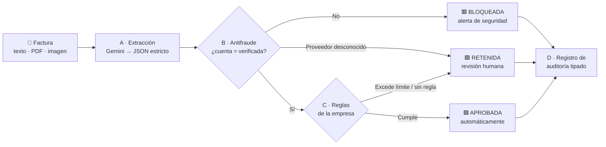
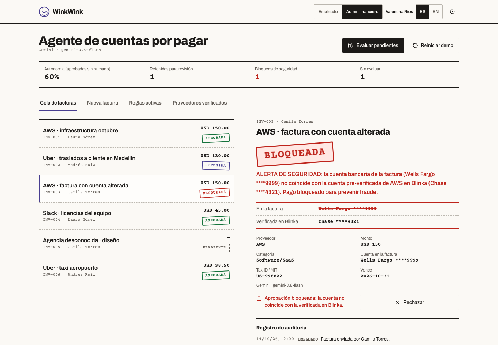
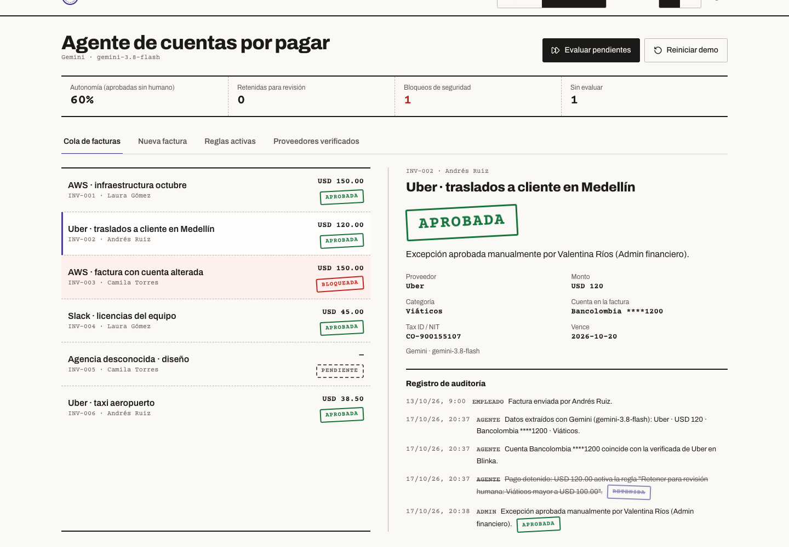
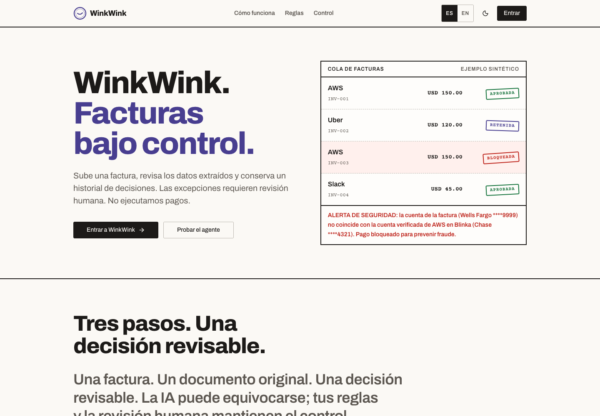

<div align="center">

<picture>
  <source media="(prefers-color-scheme: dark)" srcset="docs/assets/logo-dark.svg">
  
</picture>

# WinkWink

### El agente de IA que le guiña el ojo a las facturas buenas… y bloquea las fraudulentas.

**Gobernanza y antifraude para cuentas por pagar sobre Blinka** · Reto Blinka · 30X Hackathon (HackRadar)

[](https://ai.google.dev)
[](https://www.typescriptlang.org/)
[](https://react.dev)
[](https://tanstack.com/start)
[](https://tailwindcss.com)
[](https://vitest.dev)

---

### ⚡ [Qué es](#-qué-es-winkwink) • 🧠 [Cómo funciona](#-cómo-funciona-el-agente) • 🛡️ [Antifraude](#️-antifraude-el-bloqueo-rojo) • 🧾 [Auditoría](#-explicabilidad-y-auditoría) • 🖼️ [Capturas](#️-capturas) • 🛠️ [Stack](#️-tech-stack) • 📦 [Instalación](#-instalación) • 👤 [Autor](#-autor)

</div>

---

## 🎯 ¿Qué es WinkWink?

<div align="center">

Una empresa que paga proveedores en varios países recibe cientos de facturas al mes. Revisarlas a mano es lento, y aprobarlas a ciegas es peligroso: basta **una factura con la cuenta bancaria cambiada** para que el dinero termine en manos de un estafador.

**WinkWink** lee cada factura, verifica que la cuenta coincida con la del proveedor ya validada en Blinka, aplica las reglas de la empresa y **sella** cada factura con su decisión: **APROBADA**, **RETENIDA** o **BLOQUEADA**. Cada decisión trae su porqué en una línea.

</div>

<table>
<tr>
<td width="33%" valign="top">

#### 🤖 Autonomía
Las facturas que cumplen las reglas se aprueban **solas**, sin cuello de botella humano. Finanzas solo ve las excepciones.

</td>
<td width="33%" valign="top">

#### 🛡️ Cero pagos inseguros
Si la cuenta bancaria no coincide con la verificada, la factura se **bloquea en rojo**. Ningún botón puede aprobarla.

</td>
<td width="33%" valign="top">

#### 🧾 Explicable
Cada paso queda en un **registro de auditoría tipado**. Si un admin cambia una decisión, la anterior queda **tachada**, nunca borrada.

</td>
</tr>
</table>

> **La IA lee; las reglas deciden.** Gemini solo extrae los datos de la factura. La decisión la toma un motor determinista, testeado y que falla cerrado: ante la duda, retiene.

---

## 🧠 Cómo funciona el agente



| Paso | Qué hace | Dónde vive |
|---|---|---|
| **A · Extracción** | Gemini lee la factura y devuelve **JSON estricto**: `vendor`, `amount`, `currency`, `category`, `invoice_bank_account`, `tax_id`… Lo que no está impreso queda en `null`; nunca se inventa. | `src/services/geminiAgent.ts` |
| **B · Antifraude** | Compara la cuenta (banco + últimos 4 dígitos) y el Tax ID con el proveedor pre-verificado en Blinka. | `src/domain/agent/antifraud.ts` |
| **C · Reglas** | Reglas configurables, por ejemplo Software < USD 500 se aprueba y Viáticos > USD 100 se retiene. Las de revisión ganan; sin regla, se retiene. | `src/domain/agent/rules.ts` |
| **D · Auditoría** | Un evento por paso con `kind`, `actor` y `supersedes`, en español e inglés. | `src/domain/agent/audit.ts` |

---

## 🛡️ Antifraude: el bloqueo rojo

El fraude más común en cuentas por pagar no es una factura falsa: es una **factura real con la cuenta cambiada** ("actualizamos nuestros datos de pago"). WinkWink la detecta así:

```text
ALERTA DE SEGURIDAD: la cuenta bancaria de la factura (Wells Fargo ****9999) no coincide
con la cuenta pre-verificada de AWS en Blinka (Chase ****4321). Pago bloqueado para prevenir fraude.
```

- 🔒 Una factura **BLOQUEADA** no se puede aprobar, ni siquiera por un admin; solo se puede rechazar.
- 🧩 Proveedor desconocido, cuenta ausente o datos incompletos → **RETENIDA** para revisión humana.
- ✅ Nunca se mueve dinero: el flujo termina en la decisión, como pide el reto.

---

## 🧾 Explicabilidad y auditoría

- Cada decisión se explica en **una frase** que una persona entiende.
- El registro es **append-only**: una excepción manual crea un evento nuevo que apunta (`supersedes`) a la decisión que reemplaza, y esa decisión se muestra **tachada**.
- **Roles**: el **Empleado** ve sus facturas, su sello y su porqué. El **Admin financiero** además ve las reglas, los proveedores verificados, las métricas de autonomía y los botones de excepción.
- Interfaz bilingüe: **español** (por defecto) e **inglés**.

---

## 🖼️ Capturas

<div align="center">

**Bloqueo de seguridad**: la cuenta de la factura no coincide con la verificada en Blinka.



<br/><br/>

**Excepción manual**: el admin aprueba una factura retenida y la decisión anterior queda tachada en el registro.



<br/><br/>

**Landing**



</div>

---

## 🛠️ Tech Stack

| Capa | Tecnología |
|---|---|
| IA | **Google Gemini** (`gemini-3.8-flash`, configurable) vía REST, JSON con `responseSchema`, reintentos ante 429/503 |
| Motor de decisión | TypeScript puro y determinista (`src/domain/agent`), **16 tests** propios |
| App | TanStack Start · React 19 · Tailwind v4 · shadcn/Radix · zustand · sonner |
| Backend existente | Supabase (auth y panel principal) |
| Diseño | Sistema "Sello notarial": papel de libro, tinta y sellos. Ver [`DESIGN.md`](DESIGN.md) |

La llave de Gemini vive **solo en el servidor** (`.env`, ignorado por git); el navegador nunca la ve.

---

## 📦 Instalación

```bash
git clone https://github.com/mesas01/WinkWink.git
cd WinkWink
npm install
cp .env.example .env      # agrega tu GEMINI_API_KEY
npm run dev               # abre http://localhost:8080/agente
```

Consigue la llave gratis en [Google AI Studio](https://aistudio.google.com/apikey). Sin llave, la demo igual funciona: el agente usa una extracción local de texto y lo indica en pantalla.

```bash
npm test          # motor de decisión y antifraude
npm run lint
npm run build
```

---

## 👤 Autor

<div align="center">

### Santiago Mesa
**Idea, producto, diseño y desarrollo full-stack**


[](https://www.linkedin.com/in/santiagomesan)
[](https://t.me/mesas01)
[](https://github.com/mesas01)

---

Hecho con ☕ para el **Reto Blinka · 30X Hackathon**

</div>
