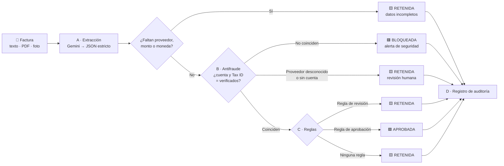
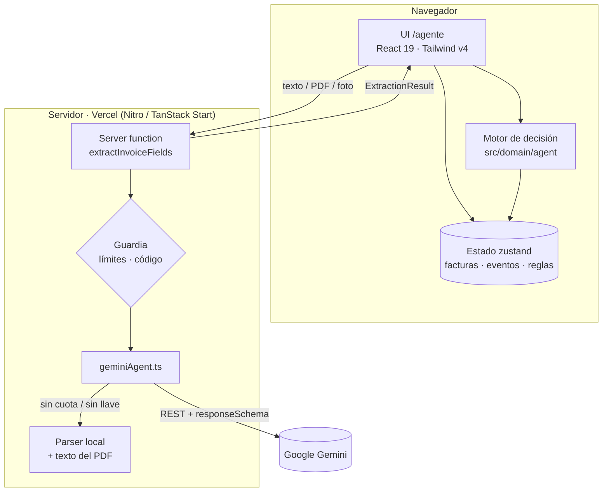

<div align="center">

<picture>
  <source media="(prefers-color-scheme: dark)" srcset="docs/assets/logo-dark.svg">
  
</picture>

# WinkWink

### El agente de IA que le guiña el ojo a las facturas buenas… y bloquea las fraudulentas.

**Gobernanza y antifraude para cuentas por pagar sobre Blinka** · Reto Blinka · 30X Hackathon (HackRadar)

### 🌐 [Pruébalo en vivo → winkwink-seven.vercel.app/agente](https://winkwink-seven.vercel.app/agente)

[](https://ai.google.dev)
[](https://www.typescriptlang.org/)
[](https://react.dev)
[](https://tanstack.com/start)
[](https://tailwindcss.com)
[](https://vitest.dev)

---

### ⚡ [Qué es](#-qué-es-winkwink) • 🧪 [Pruébalo](#-pruébalo-tú-mismo-en-2-minutos) • 📘 [Especificación](#-especificación-del-agente) • 🖼️ [Capturas](#️-capturas) • 🛠️ [Stack](#️-tech-stack) • 📦 [Instalación](#-instalación) • 👤 [Autor](#-autor)

</div>

---

## 🎯 ¿Qué es WinkWink?

<div align="center">

Una empresa que paga proveedores en varios países recibe cientos de facturas al mes. Revisarlas a mano es lento, y aprobarlas a ciegas es peligroso: basta **una factura con la cuenta bancaria cambiada** para que el dinero termine en manos de un estafador.

**WinkWink** lee cada factura, verifica que la cuenta coincida con la del proveedor ya validada en Blinka, aplica las reglas de la empresa y marca cada factura con su decisión: **APROBADA**, **RETENIDA** o **BLOQUEADA**. Cada decisión trae su porqué en una línea.

</div>

<table>
<tr>
<td width="33%" valign="top">

#### 🤖 Autonomía
Las facturas que cumplen las reglas se aprueban **solas**, sin cuello de botella humano. Finanzas solo ve las excepciones.

</td>
<td width="33%" valign="top">

#### 🛡️ Cero pagos inseguros
Si la cuenta bancaria no coincide con la verificada, la factura se **bloquea en rojo**. Ningún botón puede aprobarla.

</td>
<td width="33%" valign="top">

#### 🧾 Explicable
Cada paso queda en un **registro de auditoría tipado**. Si un admin cambia una decisión, la anterior queda **tachada**, nunca borrada.

</td>
</tr>
</table>

> **La IA lee; las reglas deciden.** Gemini solo extrae los datos de la factura. La decisión la toma un motor determinista, testeado y que falla cerrado: ante la duda, retiene.

---

## 🧪 Pruébalo tú mismo en 2 minutos

No necesitas cuenta ni instalar nada.

1. **Descarga una factura de prueba** de la carpeta [`test-invoices/`](test-invoices). Abre el PDF en GitHub y usa el botón de descarga.
2. **Abre la demo:** [winkwink-seven.vercel.app/agente](https://winkwink-seven.vercel.app/agente).
3. **Elige un rol** en la barra superior: **Admin financiero** (ve todo) o **Empleado** (solo sus facturas).
4. Ve a **Nueva factura** y **sube el PDF** (o toma una foto con la cámara del celular). Luego presiona **Enviar y evaluar**.
5. Mira cómo el agente recorre los pasos **A → D** y deja su decisión con el porqué. Como admin puedes aprobar una excepción o rechazar, y verás la decisión anterior **tachada** en el registro de auditoría.
6. **Reiniciar demo** vuelve todo al estado inicial. **Evaluar pendientes** procesa la cola de ejemplo de una vez.

| PDF de prueba | Resultado esperado |
|---|---|
| [`01-aws-aprobada.pdf`](test-invoices/01-aws-aprobada.pdf) | 🟩 Aprobada: cuenta verificada y Software < USD 500 |
| [`02-aws-fraude-cuenta-cambiada.pdf`](test-invoices/02-aws-fraude-cuenta-cambiada.pdf) | 🟥 **Bloqueada**: la cuenta no coincide con la verificada |
| [`03-figma-fraude-taxid.pdf`](test-invoices/03-figma-fraude-taxid.pdf) | 🟥 **Bloqueada**: el Tax ID no coincide |
| [`04-uber-viaticos-retenida.pdf`](test-invoices/04-uber-viaticos-retenida.pdf) | 🟨 Retenida: Viáticos supera USD 100 |
| [`05-uber-taxi-aprobada.pdf`](test-invoices/05-uber-taxi-aprobada.pdf) | 🟩 Aprobada: Viáticos por debajo de USD 100 |
| [`06-slack-aprobada.pdf`](test-invoices/06-slack-aprobada.pdf) | 🟩 Aprobada |
| [`07-proveedor-desconocido-retenida.pdf`](test-invoices/07-proveedor-desconocido-retenida.pdf) | 🟨 Retenida: proveedor no verificado |
| [`08-rappi-brl-sin-regla.pdf`](test-invoices/08-rappi-brl-sin-regla.pdf) | 🟨 Retenida: ninguna regla cubre BRL |

> 💡 Si la cuota gratuita de Gemini se agota, la demo sigue funcionando: lee el texto del PDF en el servidor y lo indica como *"Extracción local"*. Las fotos sí necesitan Gemini.

---

## 📘 Especificación del agente

> **En una frase:** WinkWink recibe una factura (texto, PDF o foto), extrae sus datos con Gemini, verifica que la cuenta bancaria y el Tax ID coincidan con los del proveedor pre-verificado en Blinka, aplica las reglas de la empresa y deja una decisión explicada y auditable: **Aprobada**, **Retenida**, **Bloqueada** o **Rechazada**. Nunca mueve dinero.

### 1. Especificación funcional

#### 1.1 Objetivo y alcance

| Entra ✅ | No entra ❌ |
|---|---|
| Leer una factura y extraer a quién, cuánto, en qué moneda y para cuándo | Ejecutar pagos reales o mover dinero |
| Decidir con reglas configurables: límites por categoría, monto y moneda | Abrir cuentas |
| Verificar la cuenta y el Tax ID contra proveedores pre-verificados | Verificar la identidad legal de empresas (KYB) |
| Escalar a una persona lo que no cumple o no se puede verificar | Decisiones de cumplimiento o adjudicación de fraude |
| Dejar registro de cada decisión: qué pasó y por qué | El diseño de la app de Blinka |

#### 1.2 Actores y permisos

| Rol | Qué ve | Qué puede hacer |
|---|---|---|
| **Empleado** | Solo sus facturas, el estado y el porqué de cada una | Subir facturas (texto, PDF o foto) y ejecutar el agente |
| **Admin financiero** | Todas las facturas, métricas, reglas activas y proveedores verificados | Todo lo anterior, más aprobar excepciones, rechazar y activar o desactivar reglas |
| **Agente** | — | Extraer, verificar, decidir y escribir en el registro |

> En la demo pública los roles se simulan en el navegador para que cualquiera pueda probar ambos lados. En la app con login (`/dashboard`), los roles viven en Supabase con *row-level security*.

#### 1.3 Entradas

| Tipo | Cómo se lee | Límite |
|---|---|---|
| Texto pegado | Gemini; si no hay cuota, parser local | 20.000 caracteres |
| PDF | Gemini; si no hay cuota, se lee la capa de texto del PDF en el servidor | 3 MB |
| Foto (cámara del celular o webcam) / imagen | Gemini (las imágenes necesitan IA) | 3 MB; la foto se reduce a 1600 px antes de subirla |

#### 1.4 Salidas: los cuatro estados

| Estado | Significado | Quién lo produce | ¿Se puede cambiar? |
|---|---|---|---|
| 🟩 **Aprobada** | Cuenta verificada y una regla autoriza el monto | Agente, o admin con una excepción | No; es final y queda en el registro |
| 🟨 **Retenida** | Falta un dato, el proveedor es desconocido, una regla pide revisión o ninguna regla cubre el caso | Agente | El admin aprueba la excepción o rechaza |
| 🟥 **Bloqueada** | La cuenta bancaria o el Tax ID no coinciden con los verificados | Agente | **Nunca se puede aprobar.** Solo rechazar |
| ⬛ **Rechazada** | Un admin la descartó | Admin | No; es final y queda en el registro |

#### 1.5 Orden de evaluación (falla cerrado)



1. **Datos completos.** Sin proveedor, monto o moneda, la factura queda retenida y no se adivina nada.
2. **Antifraude antes que reglas.** Si la cuenta o el Tax ID no coinciden, se bloquea y **las reglas ni se evalúan**.
3. **Las reglas de revisión ganan** sobre las de aprobación.
4. **Sin regla aplicable, se retiene.** Nada se aprueba por omisión.

#### 1.6 Reglas por defecto (configurables por el admin)

| # | Regla | Acción |
|---|---|---|
| R1 | Software/SaaS **menor a** USD 500 | Aprobar automáticamente |
| R2 | Viáticos **mayor a** USD 100 | Retener para revisión humana |
| R3 | Viáticos **menor a** USD 100 | Aprobar automáticamente |

Las monedas no se convierten: una regla en USD no cubre una factura en BRL o COP.

#### 1.7 Proveedores pre-verificados (datos sintéticos de la demo)

| Proveedor | Cuenta verificada | Tax ID |
|---|---|---|
| AWS | Chase ****4321 | US-998822 |
| Slack | Bank of America ****4500 | US-554310 |
| Figma | Silicon Valley Bank ****7500 | US-771204 |
| Uber | Bancolombia ****1200 | CO-900155107 |
| Rappi | Itaú ****8810 | BR-26900161 |

El nombre del proveedor se compara contra el nombre canónico y sus alias exactos (por ejemplo "Amazon Web Services" → AWS), sin coincidencias aproximadas.

#### 1.8 Explicaciones (una frase por decisión)

```text
🟩 Aprobada automáticamente: USD 150.00 cumple la regla "Aprobar automáticamente: Software/SaaS menor a USD 500.00".
🟨 Pago detenido: USD 120.00 activa la regla "Retener para revisión humana: Viáticos mayor a USD 100.00".
🟨 "Pixel Norte Studio" no está en la lista de proveedores verificados de Blinka.
🟥 ALERTA DE SEGURIDAD: la cuenta bancaria de la factura (Wells Fargo ****9999) no coincide con la cuenta
   pre-verificada de AWS en Blinka (Chase ****4321). Pago bloqueado para prevenir fraude.
```

Todas las frases existen en **español e inglés**, y la interfaz cambia de idioma al instante.

#### 1.9 Excepciones y auditoría

- El registro es **append-only**: un evento por paso (extracción, antifraude, regla, excepción).
- Una excepción del admin **no borra** la decisión del agente: crea un evento nuevo que apunta (`supersedes`) al que reemplaza, y ese queda **tachado**.
- El estado vigente de una factura es la última decisión que nadie reemplazó.

#### 1.10 Métricas del panel

| Métrica | Cómo se calcula |
|---|---|
| **Autonomía** | Facturas aprobadas **por regla del agente** ÷ facturas decididas. Las aprobaciones manuales no cuentan |
| Retenidas | Decisiones vigentes en estado Retenida |
| Bloqueos de seguridad | Decisiones vigentes en estado Bloqueada |
| Sin evaluar | Facturas sin decisión |

---

### 2. Especificación técnica

#### 2.1 Arquitectura



La **IA solo extrae**: el servidor devuelve los campos y el **motor determinista** decide en el navegador, que es código puro sin red ni efectos secundarios. Así la decisión es reproducible, testeable y explicable.

#### 2.2 Módulos

| Archivo | Responsabilidad |
|---|---|
| `src/services/geminiAgent.ts` | Paso A: llamada REST a Gemini con `responseSchema`, `temperature: 0`, validación con Zod, reintentos y fallback |
| `src/services/agent.functions.ts` | Server functions `extractInvoiceFields` y `agentStatus`; valida la entrada (Zod) |
| `src/services/agent-guard.server.ts` | Límites de uso por visitante e instancia, y código de acceso opcional |
| `src/services/pdf-text.server.ts` | Lee la capa de texto de un PDF (inflate de streams y operadores `Tj`/`TJ`) para el modo sin IA |
| `src/domain/agent/types.ts` | Tipos: `ExtractedInvoice`, `Decision`, `AuditEvent`, `PaymentRule`, `VerifiedVendor` |
| `src/domain/agent/bank.ts` | Normaliza y compara cuentas: banco + últimos 4 dígitos |
| `src/domain/agent/vendors.ts` | Proveedores verificados y búsqueda por alias exacto |
| `src/domain/agent/antifraud.ts` | Paso B: `checkVendorAccount` → `passed` / `blocked` / `unverifiable` / `unknown_vendor` |
| `src/domain/agent/rules.ts` | Paso C: `evaluateRules` con prioridad a revisión y "sin regla → retener" |
| `src/domain/agent/decide.ts` | Orquesta los pasos B–D (`runAgentDecision`) y las excepciones (`overrideDecision`) |
| `src/domain/agent/audit.ts` | Paso D: eventos tipados, `supersedes` y estado vigente |
| `src/domain/agent/offline-extract.ts` | Parser local de facturas etiquetadas (modo sin IA) |
| `src/stores/agent-store.ts` | Estado de la demo (persistido en el navegador) |
| `src/hooks/use-agent-run.ts` | Ejecuta A → D y anima los pasos en la UI |
| `src/components/agent/*` | Cola, detalle, pasos, registro, reglas, proveedores, roles y formulario con cámara |

#### 2.3 Contrato de extracción (paso A)

Gemini recibe el texto o el archivo (`inlineData`) más estas instrucciones: *"Devuelve JSON estricto según el esquema. Usa `null` para cualquier campo que no esté impreso. Nunca adivines."*

| Campo | Tipo | Nota |
|---|---|---|
| `vendor` | string \| null | Nombre del proveedor |
| `amount` | number \| null | Total |
| `currency` | string \| null | ISO 4217 (USD, COP, BRL…) |
| `category` | enum | `software` · `travel` · `marketing` · `services` · `other` |
| `invoice_bank_account` | string \| null | Cuenta a la que pide pagar, tal como está impresa |
| `tax_id` | string \| null | NIT / Tax ID |
| `invoice_number` | string \| null | |
| `due_date` | string \| null | `YYYY-MM-DD` |

La respuesta se valida con **Zod** antes de usarse; si no cumple el esquema, se descarta.

#### 2.4 Algoritmo de decisión (pasos B–D)

```ts
runAgentDecision(invoiceId, extraction, vendors, rules):
  events = [extracted]
  if falta vendor | amount | currency  → RETENIDA (incomplete)
  fraud = checkVendorAccount(invoice, vendors)
  if fraud = blocked                   → BLOQUEADA (security_blocked) + comparación de cuentas
  if fraud = unknown | unverifiable    → RETENIDA (unknown_vendor)
  events += security_passed
  outcome = evaluateRules(invoice, rules)   // revisión > aprobación > ninguna
  approve → APROBADA (rule_approved) | review → RETENIDA (rule_halted) | none → RETENIDA (no_rule)
```

Dos cuentas son iguales solo si coinciden el **banco** (normalizado) y los **últimos 4 dígitos**. Si una no se puede leer, no coincide.

#### 2.5 Modelo de auditoría

```ts
interface AuditEvent {
  id: string;
  invoiceId: string;
  kind: "submitted" | "extracted" | "security_passed" | "security_blocked" | "unknown_vendor"
      | "rule_approved" | "rule_halted" | "no_rule" | "incomplete"
      | "override_approved" | "override_rejected";
  actor: "agent" | "admin" | "employee";
  at: string;                      // ISO 8601
  message: { es: string; en: string };
  supersedes: string | null;       // evento que reemplaza → se muestra tachado
}
```

`overrideDecision` se niega a aprobar una decisión vigente de tipo `security_blocked`.

#### 2.6 Resiliencia

| Situación | Comportamiento |
|---|---|
| Gemini saturado (503) o con límite de tasa (429) | Reintenta 3 veces (0,7 s · 1,5 s · 3 s) |
| Cuota agotada (429 "quota") | No reintenta; pasa a extracción local y lo indica en pantalla |
| Sin `GEMINI_API_KEY` | Extracción local de texto y PDFs |
| Imagen sin Gemini disponible | Error claro: "sube un PDF con texto o pega el contenido" |
| Modelo no disponible | Configurable con `GEMINI_MODEL` (por defecto `gemini-3.8-flash`) |

#### 2.7 Seguridad

- **La llave de Gemini vive solo en el servidor** y no aparece en el código que descarga el navegador (verificado en el build).
- **Validación de entrada** con Zod: tipos MIME permitidos, 3 MB por archivo, 20.000 caracteres de texto.
- **Límites de uso**: 8 por minuto y 60 por día por visitante, y 600 por día por instancia.
- **Código de acceso opcional** (`DEMO_ACCESS_CODE`), comparado en tiempo constante.
- **Encabezados**: HSTS, `X-Content-Type-Options: nosniff`, `X-Frame-Options: DENY`, `frame-ancestors 'none'` y `Permissions-Policy: camera=(self)`.
- **Datos**: todo es sintético. `.env` está fuera de git y se revisó el historial en busca de secretos.

#### 2.8 Pruebas

**27 pruebas del agente** (100 en el proyecto) con Vitest:
- Comparación de cuentas y alias exactos.
- Bloqueo por cuenta y por Tax ID.
- Reglas: prioridad, moneda distinta y reglas apagadas.
- Que una factura bloqueada nunca se apruebe.
- Excepciones con `supersedes` y límites de uso.
- Los **8 PDFs de `test-invoices/`** reciben exactamente su decisión esperada.

#### 2.9 Despliegue

| | |
|---|---|
| Hosting | **Vercel**, preset Nitro `vercel`, función Node 24. Cada push a `main` se despliega solo |
| Variables | `GEMINI_API_KEY` (secreta), `GEMINI_MODEL`, `DEMO_ACCESS_CODE` (opcional) y las públicas de Supabase |
| URL | https://winkwink-seven.vercel.app |

---

### 3. Cómo se construyó

1. **Prototipo en Lovable:** interfaz inicial, login y base de datos en Supabase.
2. **Exportación a código propio:** repositorio en GitHub, limpieza de dependencias y lint en cero errores.
3. **Agente real:** se diseñó primero el motor determinista (tipos, antifraude, reglas y auditoría) como código puro y testeado, y después se conectó Gemini solo para leer. Como los secretos de Lovable Cloud no estaban disponibles, el agente corre de forma autónoma: server function + estado local.
4. **Seguridad y despliegue:** límites de uso, código de acceso, encabezados, fallback sin cuota y deploy en Vercel.
5. **Diseño:** dos iteraciones guiadas por skills de diseño (Impeccable, Emil Kowalski, Apple design y taste-skill) hasta el estilo actual: limpio, con vidrio translúcido y animaciones con resortes.
6. **Material de prueba:** generador de PDFs sintéticos (`npm run invoices:generate`) y video demo narrado y reproducible (`npm run demo:record`).

Desarrollo asistido por IA con **Claude Code**: cada cambio se verificó con TypeScript, lint, pruebas, build y capturas reales en escritorio y móvil.

### 4. Limitaciones conocidas y siguientes pasos

- Los roles y la cola de la demo se guardan en el navegador. El siguiente paso es persistir facturas y eventos en Supabase, con los mismos tipos.
- Los límites de uso se cuentan por instancia del servidor; para uno global, un almacén compartido (Redis o KV).
- Las fotos necesitan Gemini. Los PDFs escaneados sin capa de texto, también.
- Proveedores y reglas son de ejemplo. En producción vendrían del registro verificado de Blinka.

---

## 🖼️ Capturas

<div align="center">

**Bloqueo de seguridad**: la cuenta de la factura no coincide con la verificada en Blinka.


<br/><br/>

**Excepción manual**: el admin aprueba una factura retenida y la decisión anterior queda tachada en el registro.


<br/><br/>

**Landing**


</div>

---

## 🛠️ Tech Stack

| Capa | Tecnología |
|---|---|
| IA | **Google Gemini** (`gemini-3.8-flash`, configurable) vía REST, JSON con `responseSchema`, reintentos ante 429/503 |
| Motor de decisión | TypeScript puro y determinista (`src/domain/agent`), **27 tests** del agente, antifraude y PDFs (100 en total) |
| App | TanStack Start · React 19 · Tailwind v4 · shadcn/Radix · zustand · sonner |
| Backend existente | Supabase (auth y panel principal) |
| Diseño | Estilo Apple: tipografía del sistema, vidrio translúcido, un solo acento azul y animaciones con resortes. Ver [`DESIGN.md`](DESIGN.md) |

La llave de Gemini vive **solo en el servidor** (`.env`, ignorado por git); el navegador nunca la ve.

**Seguridad en el despliegue público:**
- 🚦 Límite de uso de Gemini por visitante (8 por minuto y 60 por día) y por instancia.
- 🔑 Código de acceso opcional para la demo (`DEMO_ACCESS_CODE`), comparado en tiempo constante.
- 🧱 Encabezados HSTS, `nosniff`, anti-iframe (`frame-ancestors 'none'`) y cámara permitida solo para el propio sitio.
- 🪂 Si Gemini se queda sin cuota, el agente sigue funcionando con extracción local y lo indica.
- 📷 Fotos con la cámara del móvil o la webcam, reducidas a 1600 px antes de subirlas.

---

## 📦 Instalación

```bash
git clone https://github.com/mesas01/WinkWink.git
cd WinkWink
npm install
cp .env.example .env      # agrega tu GEMINI_API_KEY
npm run dev               # abre http://localhost:8080/agente
```

Consigue la llave gratis en [Google AI Studio](https://aistudio.google.com/apikey). Sin llave, la demo igual funciona: el agente usa una extracción local de texto y lo indica en pantalla.

```bash
npm test                    # motor de decisión, antifraude y PDFs de prueba
npm run lint
npm run build
npm run invoices:generate   # regenera los PDFs de test-invoices/
npm run demo:record         # graba el video demo narrado (macOS + Chrome + ffmpeg)
```

---

## 👤 Autor

<div align="center">

### Santiago Mesa
**Idea, producto, diseño y desarrollo full-stack**


[](https://www.linkedin.com/in/santiagomesan)
[](https://t.me/mesas01)
[](https://github.com/mesas01)

---

Hecho con ☕ para el **Reto Blinka · 30X Hackathon**

</div>
